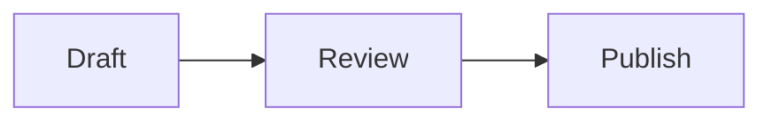

# Rich notes in T3 Code chat

Assistant replies can use the existing GitHub-style Markdown (headings, task lists, tables, footnotes, and alerts such as `> [!NOTE]`). They render in the regular scrolling timeline. Use `<details>` with a `<summary>` for collapsible sections. The timeline's activity rows remain the place to expand provider-supplied reasoning summaries and inspect tool inputs and outputs when available; the renderer does not collect any additional private reasoning or tool data.

## Inline styles

Ask the assistant to write a Markdown note and use inline code spans of the form `` `t3:accent,strong|Decision` `` to style short phrases. The characters after the first `|` are plain text. A span can combine at most one style from each column:

| Color                        | Size             | Weight             | Font            | Background          | Decoration            |
| ---------------------------- | ---------------- | ------------------ | --------------- | ------------------- | --------------------- |
| `accent`, `muted`, `warning` | `small`, `large` | `medium`, `strong` | `mono`, `serif` | `highlight`, `chip` | `underline`, `strike` |

Unknown or conflicting styles stay literal code. Ordinary fenced code stays literal. Use ordinary Markdown for links and formatting inside a phrase. Other Markdown renderers will display the extension as inline code. This uses a fixed palette; it does not call a second model or accept arbitrary CSS.

### Try it

Ask the assistant to return the following Markdown verbatim, without wrapping it in a code fence:

```markdown
## Release notes

> [!NOTE]
> `t3:accent,strong|Ready for review` — the changes are on the feature branch.

- [x] Check the formatter
- [ ] Try the desktop build

`t3:muted,small|Last updated today`
```

## Inline charts, diagrams, and media

Use these directly in an assistant reply; they appear in the same scrolling timeline as the surrounding text:

````markdown
```t3-chart
Build time (seconds)
Before | 20
After | 8
```




````

Charts use a title followed by up to 24 `label | value` rows with unique labels and finite nonnegative numbers. Labels and exact values remain readable alongside the bars. Charts are HTML and CSS rendered by the chat itself: no iframe, fetch, or extra chart engine. Mermaid diagrams, expandable images, and inline video controls use T3 Code's existing renderers. For images and videos, use readable workspace files or direct media URLs, not links to player pages.

## Run the desktop fork

From the repository root, use the Node version specified in `package.json` and run:

```sh
npx -y pnpm@12.14.0 install --frozen-lockfile
npx -y pnpm@12.14.0 dev:desktop --home-dir "$HOME/.t3-notes-dev" --no-seed
```

The separate home and `--no-seed` keep the stock app and its data untouched. To run in a local browser instead, use `dev` in place of `dev:desktop` and open the URL printed by Vite.
